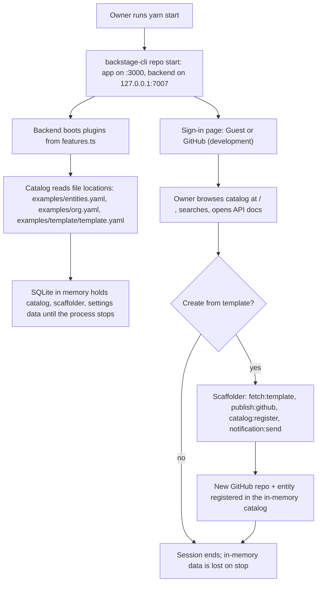
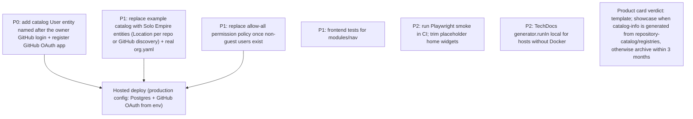

# 01 — Business process (As-Is / To-Be)

repo นี้คือ Backstage developer portal (Backstage `1.55.3` ตาม `backstage.json`) ที่ยังใกล้ upstream scaffold ใช้โดย owner คนเดียว รันบนเครื่อง owner เท่านั้น (ไม่มี hosted deploy, ไม่มี live URL ตาม `PRODUCT.md`) catalog โหลดเฉพาะ entity ตัวอย่างใน `examples/`

## As-Is (จาก code วันนี้)

ข้อสังเกต: scaffolder step `publish:github` ใช้ `integrations.github[].token: ${GITHUB_TOKEN}` ถ้าไม่ตั้ง `GITHUB_TOKEN` ขั้นนี้จะทำงานไม่ได้ (ไม่มี test ครอบ flow นี้) entity ที่ register ระหว่างใช้งานหายเมื่อ backend หยุด เพราะ DB เป็น `':memory:'`

Sources: `README.md`, `PRODUCT.md`, `package.json`, `app-config.yaml`, `packages/backend/src/index.ts`, `packages/backend/src/features.ts`, `examples/template/template.yaml`, `packages/app/src/modules/signIn/providers.ts`

## To-Be (จาก `docs/UPGRADE-PLAN.md` และ `DOCPACK/00-product-card.md` เท่านั้น)

ยังไม่มี hosting target ที่ตัดสินใจแล้วใน repo (`PRODUCT.md`: "describes a future hosted setup ... that has not been provisioned")

Sources: `docs/UPGRADE-PLAN.md`, `DOCPACK/00-product-card.md`, `PRODUCT.md`

## Open questions
- จะใช้ Backstage ต่อ หรือคง `repository-catalog` เป็น catalog หลัก (product card ข้อ 8.2 ยังรอพิจารณา)
- ถ้า host: ที่ไหน (Railway / container อื่น), Postgres ที่ไหน, domain อะไร
- เส้นตาย "archive ภายใน 3 เดือน" นับจาก 2026-10-08 (วันที่ product card) ใช่หรือไม่
