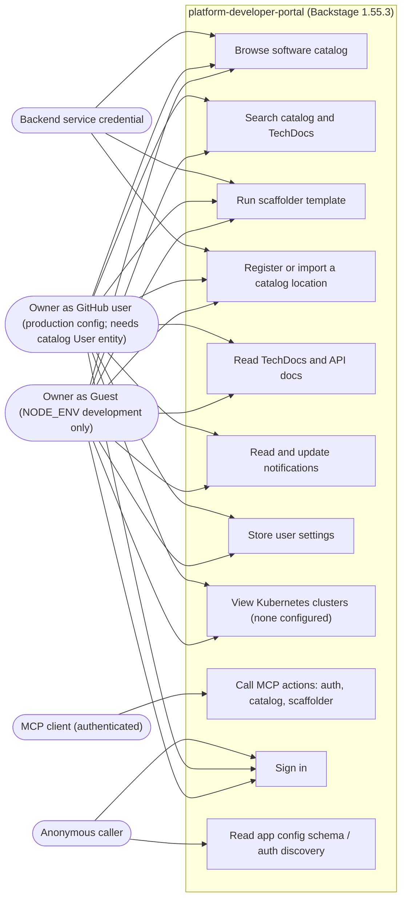

# 02 — Use cases

actor มาจากระดับ auth ที่ code กำหนดจริง: guest (dev เท่านั้น), GitHub user (production config), service credential, caller ที่ไม่ authenticate (route ที่ `routeAccess.test.ts` จัดเป็น `public`), และ MCP client ที่เรียก `/api/mcp-actions/v1` (route ระดับ `user`)

หมายเหตุ

- permission policy คือ `permission-backend-module-allow-all-policy` → ผู้ที่ sign in แล้วทุกคนทำได้ทุก use case (ไม่มี role แยก)
- guest provider ปฏิเสธการ authenticate เมื่อ `NODE_ENV` ไม่ใช่ `development` (comment ใน `features.ts`, test ใน `appConfig.test.ts`) และ production sign-in page แสดงเฉพาะ GitHub (`providers.ts`)
- GitHub sign-in ใช้ resolver `usernameMatchingUserEntityName`: ต้องมี `User` entity ชื่อเท่ากับ GitHub login; วันนี้ catalog มีแค่ `User` ชื่อ `guest` (`examples/org.yaml`) → GitHub user ทุกคนถูกปฏิเสธ (gap, P0 ใน UPGRADE-PLAN)
- service credential: route test ยืนยันว่าผ่านชั้น auth ได้ (`not 401`) แต่ไม่มี service จริงที่เรียก portal ใน repo

Sources: `packages/backend/src/features.ts`, `packages/backend/src/routeAccess.test.ts`, `packages/backend/src/appConfig.test.ts`, `packages/app/src/modules/signIn/providers.ts`, `app-config.yaml`, `app-config.production.yaml`, `examples/org.yaml`

## Open questions

- จะมี service อื่นใน Solo Empire เรียก portal ด้วย service credential หรือไม่ (`backend.auth.keys` ยัง comment อยู่ใน `app-config.yaml`)
- MCP actions จะเปิดให้ client ใด (เช่น MCP hub) ใช้หรือไม่; ตอนนี้ `auth.clientIdMetadataDocuments.enabled: false`
