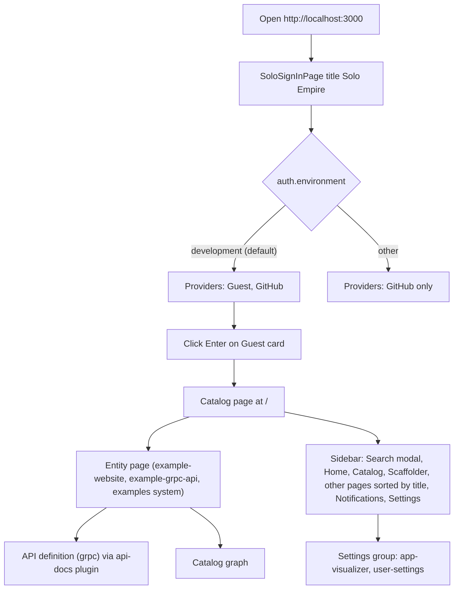
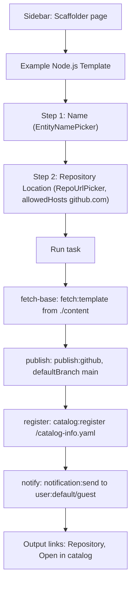
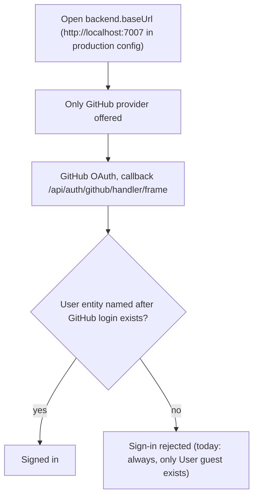

# 03 — User flows

frontend ใช้ Backstage new frontend system (`createApp` จาก `@backstage/frontend-defaults`) features ที่ใส่เองใน `App.tsx` = `catalogPlugin`, `navModule`, `homeModule`, `signInModule`; plugin อื่นใน `packages/app/package.json` ถูก enable อัตโนมัติจาก `app.packages: all` path ที่ config กำหนดเอง: `page:catalog` → `/` ที่เหลือใช้ path default ของแต่ละ plugin

## Flow A — Development sign-in และใช้งาน catalog

## Flow B — Create from template (scaffolder)

## Flow C — Production sign-in (config only, not deployed)

Sources: `packages/app/src/App.tsx`, `packages/app/src/modules/nav/Sidebar.tsx`, `packages/app/src/modules/signIn/SignInPage.tsx`, `packages/app/src/modules/signIn/providers.ts`, `packages/app/src/modules/home/homeModule.tsx`, `packages/app/package.json`, `app-config.yaml`, `app-config.production.yaml`, `examples/entities.yaml`, `examples/template/template.yaml`, `packages/app/e2e-tests/app.test.ts`, `README.md`

## Open questions
- widget Getting Started ใน `homeModule.tsx` ลิงก์ไป `/catalog` แต่ catalog ถูกย้ายไป `/` — ลิงก์นี้ยังใช้ได้หรือไม่ (ยังไม่ได้ตรวจใน browser)
- path ของ home page ไม่ได้ override ใน config (ใช้ default ของ `plugin-home`); ยังไม่ได้ยืนยันใน app ที่รันจริง
