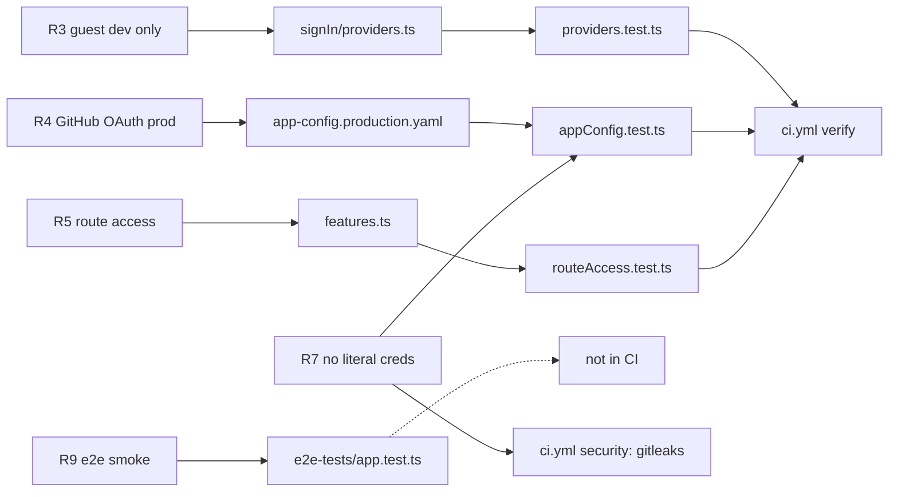

# 04 — Traceability (RTM)

ไม่มี `specs/` ใน repo requirement มาจาก `PRODUCT.md` ("What works today") และ backlog ใน `docs/UPGRADE-PLAN.md` release/workflow: ไม่มี release หรือ deploy workflow มีแค่ `.github/workflows/ci.yml` (job `verify` + `security`)

| ID | Requirement (source) | Code module | Test file | CI / release |
|---|---|---|---|---|
| R1 | App + backend start locally with `yarn start` (PRODUCT.md) | `packages/app/src/App.tsx`, `packages/backend/src/index.ts`, `features.ts` | `packages/app/src/App.test.tsx` (render), `routeAccess.test.ts` (backend starts the real list) | `verify`: Unit tests, Build backend bundle |
| R2 | Catalog loads only example entities (PRODUCT.md) | `app-config.yaml` / `app-config.production.yaml` `catalog.locations`, `examples/` | `appConfig.test.ts` (file locations resolve, dev cwd and image root) | `verify`: Unit tests |
| R3 | Guest sign-in in development only (PRODUCT.md, UPGRADE-PLAN pass 2) | `modules/signIn/providers.ts`, `SignInPage.tsx`, `features.ts` (guest module) | `providers.test.ts`, `SignInPage.test.tsx`, `appConfig.test.ts` | `verify` |
| R4 | GitHub OAuth in production with catalog-matched user (PRODUCT.md) | `app-config.production.yaml` `auth.providers.github`, `features.ts` (github module) | `appConfig.test.ts` (env substitution, resolver, no catalog-less fallback), `providers.test.ts` | `verify` (no deploy) |
| R5 | Every installed plugin route classified; no unprotected write route (UPGRADE-PLAN pass 2) | `features.ts` | `routeAccess.test.ts` | `verify` |
| R6 | Dev backend on loopback; production listens `:7007` (UPGRADE-PLAN pass 2) | `app-config.yaml` `backend.listen.host`, `app-config.production.yaml` | `appConfig.test.ts` | `verify` |
| R7 | No literal credentials in config; secrets from env (UPGRADE-PLAN pass 1) | `app-config*.yaml` | `appConfig.test.ts` (credential pattern) | `security` / gitleaks |
| R8 | CI: install, tsc, lint, prettier, tests, backend build + shared security (PRODUCT.md) | `.github/workflows/ci.yml` | — | `verify`, `security` |
| R9 | Playwright smoke test (PRODUCT.md: not run in CI) | `playwright.config.ts` | `packages/app/e2e-tests/app.test.ts` | **gap**: not in CI (UPGRADE-PLAN P2) |
| B1 | P0: catalog `User` entity for owner GitHub login | — (not implemented) | — | **gap** |
| B2 | P1: Solo Empire entities replace examples; real org; owner in `catalog-info.yaml` | — (still `john@example.com`) | — | **gap** |
| B3 | P1: replace allow-all permission policy | — (`permissionBackendModuleAllowAllPolicy` in `features.ts`) | — | **gap** |
| B4 | P1: frontend tests for `modules/nav` | `modules/nav/Sidebar.tsx` | — | **gap** |
| B5 | P2: TechDocs `generator.runIn: local` | `app-config.yaml` still `runIn: 'docker'` | — | **gap** |

Sources: `PRODUCT.md`, `docs/UPGRADE-PLAN.md`, `.github/workflows/ci.yml`, `packages/backend/src/*.test.ts`, `packages/app/src/**/*.test.ts*`, `packages/app/e2e-tests/app.test.ts`, `catalog-info.yaml`

## Open questions
- ไม่มี spec ทางการ (SDD ตาม ADR-0004 กลาง) — ต้องการ `specs/` สำหรับ repo นี้หรือไม่ ในเมื่อสถานะยังเป็น template
