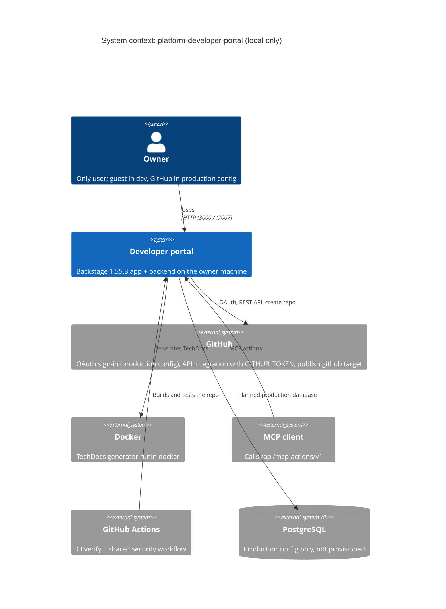

# 05 — C4 Context

ไม่มี system อื่นใน Solo Empire (gateway, uptime, MCP hub, Sentry) ที่เชื่อมกับ portal นี้ใน code หรือ ops record ที่อ่าน

Sources: `app-config.yaml`, `app-config.production.yaml`, `packages/backend/src/features.ts`, `.github/workflows/ci.yml`, `PRODUCT.md`, `README.md`

## Open questions

- MCP client ใดจะใช้ MCP actions จริง (ไม่มี config ฝั่ง client ใน repo)
