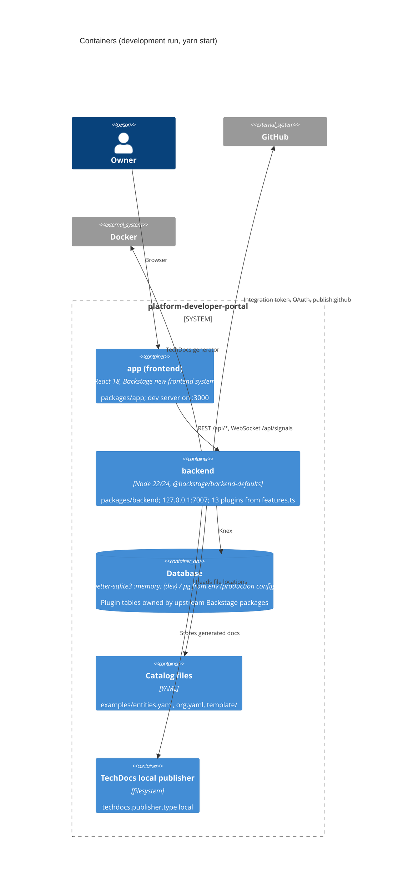

# 06 — C4 Container

ใน production config `app.baseUrl` = `backend.baseUrl` = `http://localhost:7007` และ backend depend on `"app": "link:../app"` (`plugin-app-backend` เสิร์ฟ bundle ของ app) — container เดียวจาก `packages/backend/Dockerfile` (`node:24-trixie-slim`) แต่ไม่เคย build หรือ push image (PRODUCT.md)

Sources: `packages/app/package.json`, `packages/backend/package.json`, `packages/backend/Dockerfile`, `packages/backend/src/features.ts`, `app-config.yaml`, `app-config.production.yaml`, `package.json`, `PRODUCT.md`

## Open questions
- Postgres instance สำหรับ production (ยังไม่ provision)
