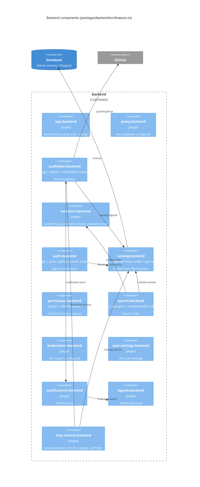

# 07 — C4 Component (backend)

backend = `createBackend()` แล้ว `backend.add()` ทุก feature ใน `backendFeatures` ตามลำดับ (`index.ts`) ไม่มี custom plugin (`plugins/` มีแค่ README)

Frontend custom modules (ส่วนที่ repo เขียนเอง): `modules/signIn` (`SoloSignInPage` + `signInProviders`), `modules/nav` (`SidebarContent`), `modules/home` (widget Getting Started)

Sources: `packages/backend/src/index.ts`, `packages/backend/src/features.ts`, `app-config.yaml`, `examples/template/template.yaml`, `packages/app/src/App.tsx`, `packages/app/src/modules/**`, `plugins/README.md`

## Open questions
- `search-backend-module-pg` ต้องใช้ Postgres; ใน dev (SQLite) engine ที่ใช้จริงคืออะไร — พฤติกรรม fallback เป็นของ upstream Backstage ยังไม่ได้ยืนยันใน repo
