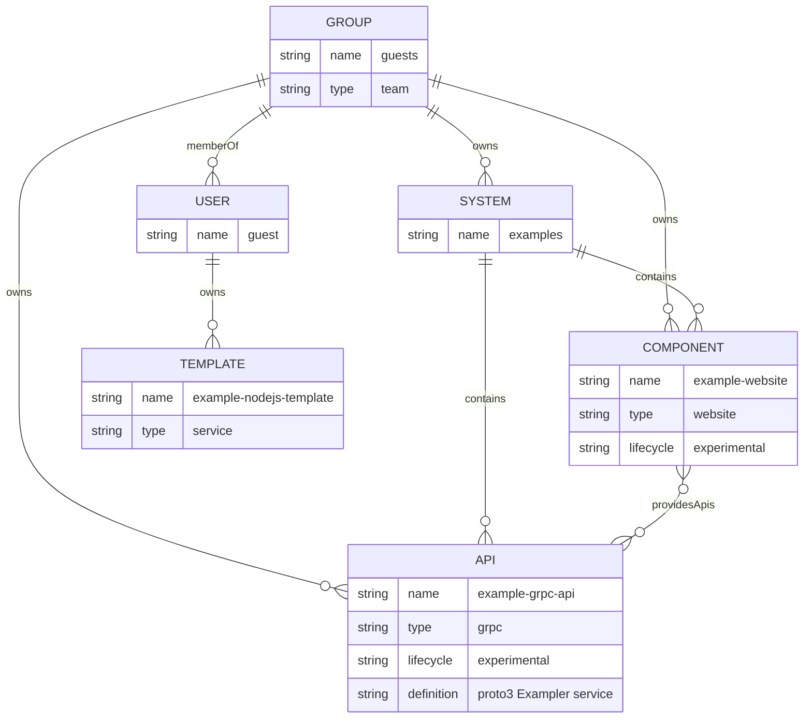

# 09 — ERD

repo ไม่มี schema / migration / model ของตัวเอง ตารางใน DB (SQLite `:memory:` ใน dev, Postgres ใน production config) สร้างโดย migration ของ plugin upstream (catalog, scaffolder, auth, search pg, user-settings, notifications ฯลฯ) ซึ่งไม่อยู่ใน repo จึงไม่วาดตารางเหล่านั้น

ข้อมูลที่ repo เป็นเจ้าของจริงคือ **catalog entity** ใน `examples/*.yaml` ด้านล่างคือ entity model ตาม relation ที่ไฟล์ประกาศ (`spec.owner`, `spec.system`, `providesApis`, `memberOf`)

kind ที่ catalog รับ: `Component, System, API, Resource, Location` (rule ทั่วไป), `Template` (เฉพาะ location template), `User, Group` (เฉพาะ `examples/org.yaml`) ไฟล์ `catalog-info.yaml` ที่ root เป็น `Component` ชื่อ `solo-empire-backstage` (owner `john@example.com`) แต่ **ไม่ได้อยู่ใน `catalog.locations`** จึงไม่ถูกโหลด

Sources: `examples/entities.yaml`, `examples/org.yaml`, `examples/template/template.yaml`, `app-config.yaml` (`catalog.rules`, `catalog.locations`), `app-config.production.yaml`, `catalog-info.yaml`, `packages/backend/package.json`

## Open questions

- ตาราง upstream ใดที่จะต้อง backup เมื่อมี Postgres จริง (ขึ้นกับ plugin version ตอน provision)
