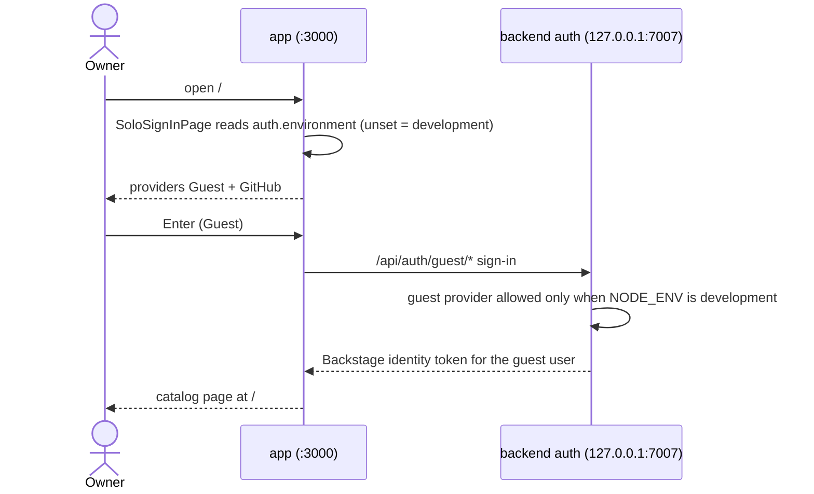
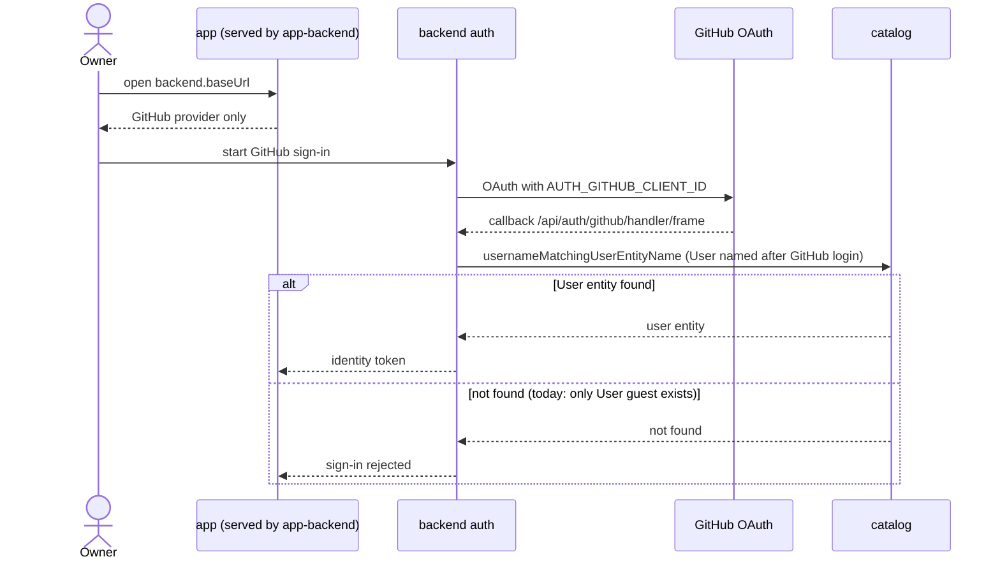
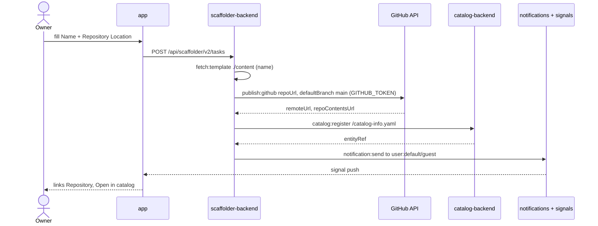
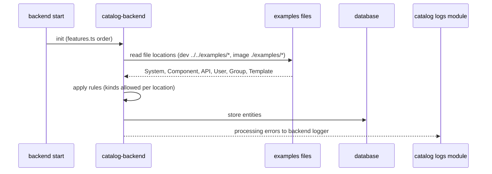

# 10 — Sequences

## 1. Development guest sign-in

## 2. Production GitHub sign-in (config only)

## 3. Scaffolder template run

## 4. Catalog ingestion at startup

Sources: `packages/app/src/modules/signIn/*`, `packages/backend/src/features.ts`, `app-config.yaml`, `app-config.production.yaml`, `README.md`, `examples/template/template.yaml`, `examples/*.yaml`, `packages/backend/src/routeAccess.test.ts`

## Open questions

- sign-in path ของ guest (`/api/auth/guest/...`) เป็น path ของ upstream; repo ไม่ได้ probe ใน route test นอกจาก `/.well-known/openid-configuration`
