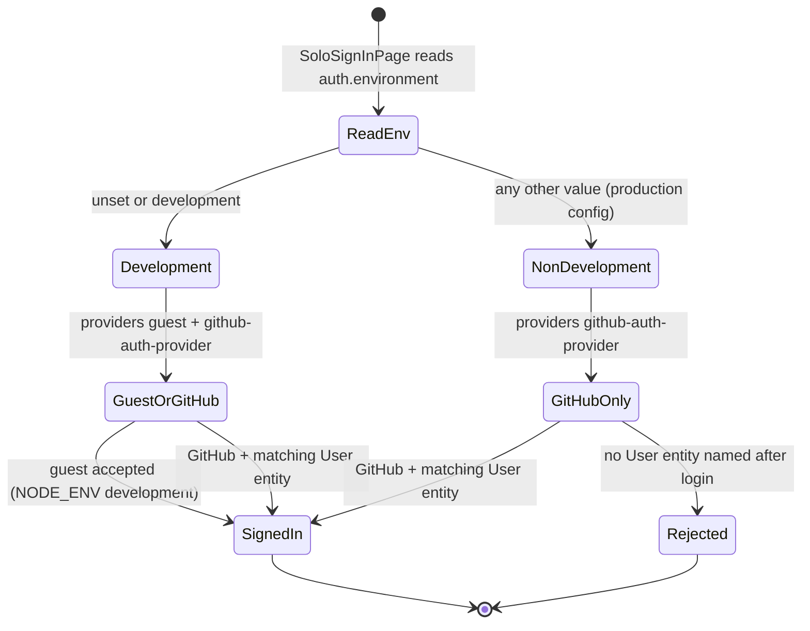
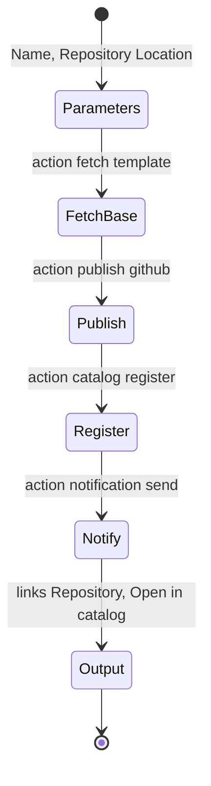

# 11 — State machines

ไม่มี entity ที่ repo กำหนด status field เอง (ไม่มี schema ของตัวเอง) lifecycle ที่ปรากฏใน code:

## 1. Sign-in provider selection (repo code)

## 2. Example template steps (from template.yaml)

ชื่อ action จริงใน template: `fetch:template`, `publish:github`, `catalog:register`, `notification:send` (ตัด `:` ออกใน label เพื่อให้ Mermaid parse)

## 3. Entity lifecycle field

entity ตัวอย่างและ `catalog-info.yaml` ใช้ `spec.lifecycle: experimental` ค่าเดียว ไม่มี code ที่เปลี่ยนค่า จึงไม่มี transition ให้วาด สถานะ task ของ scaffolder (เช่น processing / completed / failed / cancelled) เป็นของ upstream `scaffolder-backend` ไม่ได้กำหนดใน repo — route `POST /api/scaffolder/v2/tasks/x/cancel` ปรากฏใน `routeAccess.test.ts` เท่านั้น

Sources: `packages/app/src/modules/signIn/providers.ts`, `SignInPage.tsx`, `app-config.production.yaml`, `examples/template/template.yaml`, `examples/entities.yaml`, `catalog-info.yaml`, `packages/backend/src/routeAccess.test.ts`
