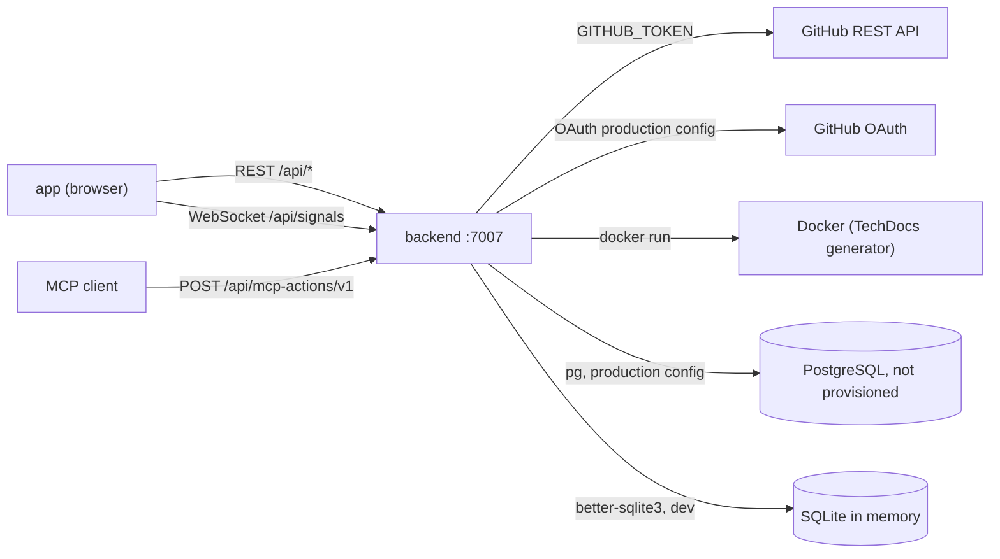

# 12 — API and integrations

## Backend endpoints (one representative route per installed plugin)

รายการนี้มาจาก `EXPECTED` ใน `routeAccess.test.ts` ซึ่ง test บังคับว่าทุก plugin ที่ติดตั้งต้องอยู่ในรายการ ไม่ใช่รายการ route ครบทุกเส้นของ upstream

| Plugin        | Method + path                                                                                                                                                          | Level                          |
| ------------- | ---------------------------------------------------------------------------------------------------------------------------------------------------------------------- | ------------------------------ |
| app           | `GET /api/app/.config-schema`                                                                                                                                          | public                         |
| proxy         | `GET /api/proxy/unconfigured`                                                                                                                                          | user (no endpoints configured) |
| scaffolder    | `GET /api/scaffolder/v2/actions`, `POST /api/scaffolder/v2/tasks`, `POST /api/scaffolder/v2/dry-run`, `POST /api/scaffolder/v2/tasks/x/cancel`                         | user                           |
| techdocs      | `GET /api/techdocs/metadata/entity/default/component/x`, `GET /api/techdocs/sync/default/component/x`                                                                  | user                           |
| auth          | `GET /api/auth/.well-known/openid-configuration` (+ sign-in endpoints)                                                                                                 | public                         |
| catalog       | `GET /api/catalog/entities`, `POST /api/catalog/locations`, `DELETE /api/catalog/entities/by-uid/x`, `POST /api/catalog/refresh`, `POST /api/catalog/analyze-location` | user                           |
| permission    | `POST /api/permission/authorize`                                                                                                                                       | user                           |
| search        | `GET /api/search/query`                                                                                                                                                | user                           |
| kubernetes    | `GET /api/kubernetes/clusters`                                                                                                                                         | user                           |
| user-settings | `PUT /api/user-settings/buckets/b/keys/k`                                                                                                                              | user                           |
| notifications | `GET /api/notifications`, `POST /api/notifications/update`                                                                                                             | user                           |
| signals       | `GET /api/signals` (WebSocket upgrade checks its own token)                                                                                                            | public                         |
| mcp-actions   | `POST /api/mcp-actions/v1`                                                                                                                                             | user                           |

`user` = anonymous ได้ 401, user/service credential ผ่านชั้น auth (ไม่ใช่ 401)

## External integrations

| Integration  | Config                                                                                                   | Used by                                         | Status                                           |
| ------------ | -------------------------------------------------------------------------------------------------------- | ----------------------------------------------- | ------------------------------------------------ |
| GitHub API   | `integrations.github[host github.com].token: ${GITHUB_TOKEN}`                                            | catalog URL reader, scaffolder `publish:github` | env only; not set by any repo script             |
| GitHub OAuth | production `auth.providers.github.production` from `AUTH_GITHUB_CLIENT_ID` / `AUTH_GITHUB_CLIENT_SECRET` | auth-backend github provider                    | OAuth app not registered (P0)                    |
| PostgreSQL   | production `backend.database` from `POSTGRES_*` env                                                      | all plugins, search pg engine                   | not provisioned                                  |
| Docker       | `techdocs.generator.runIn: 'docker'`                                                                     | techdocs-backend                                | needs local Docker; no entity has TechDocs today |
| MCP clients  | `backend.actions.pluginSources: auth, catalog, scaffolder`; `mcpActions.name: 'My Company Backstage'`    | mcp-actions-backend                             | no client configured in repo                     |
| Proxy        | `proxy.endpoints` commented out                                                                          | proxy-backend                                   | none                                             |

Sources: `packages/backend/src/routeAccess.test.ts`, `packages/backend/src/features.ts`, `app-config.yaml`, `app-config.production.yaml`, `README.md`, `examples/template/template.yaml`

## Open questions

- จะ expose OpenAPI / API docs ของ Solo Empire services ผ่าน `plugin-api-docs` หรือไม่ (วันนี้มีแค่ `example-grpc-api`)
