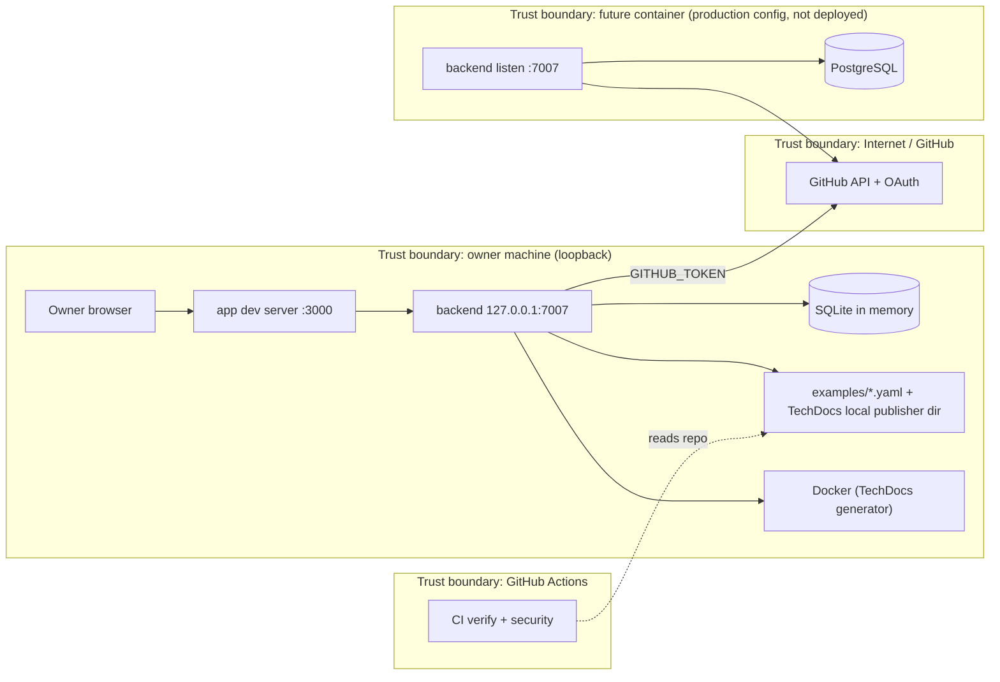

# 13 — Threat model (DFD + STRIDE)

## DFD

## STRIDE

| Element | Threat | Existing mitigation (code) | Gap |
|---|---|---|---|
| backend (dev) | S: anyone signs in as guest | `backend.listen.host: 127.0.0.1` pinned by `appConfig.test.ts`; guest refused outside `NODE_ENV=development` | none for local use |
| backend (prod config) | S: GitHub user without catalog entry | resolver `usernameMatchingUserEntityName`; test forbids `dangerouslyAllowSignInWithoutUserInCatalog` and `dangerouslyAllowOutsideDevelopment` | no owner `User` entity yet (P0) |
| backend routes | E: anonymous write | `routeAccess.test.ts`: every installed plugin classified; all write probes 401 for anonymous | test covers one representative route per plugin, not every route |
| permission | E: any signed-in user does everything | `permission.enabled: true` | policy is allow-all (P1) |
| backend service auth | S: forged service call | Backstage default service auth | `backend.auth.keys` commented out; no external service tokens configured |
| signals / auth endpoints | I: public routes | classified public by design; signals checks token on upgrade | — |
| CORS / CSP | T/I: cross-origin calls | `cors.origin: http://localhost:3000`, `credentials: true`; CSP via Helmet | `csp.connect-src` allows any `http:` and `https:` |
| config / secrets | I: committed credentials | `${ENV}` substitution only; credential regex test; gitleaks in CI; `.gitleaksignore` (one reviewed bundled Yarn finding) | no secret manager integration in repo |
| GitHub token | E: broad PAT used by scaffolder | token from env only | scope of `GITHUB_TOKEN` not documented |
| scaffolder | T: template runs `publish:github` / `catalog:register` | `RepoUrlPicker allowedHosts: github.com` | allow-all means any signed-in user can create repos |
| TechDocs | E: docs build executes in Docker | `runIn: 'docker'` isolates generator | needs Docker daemon access on host |
| dependencies | T: vulnerable packages | osv-scanner, trivy-fs, semgrep in `security.yml`; reviewed ignores expire 2027-01-17; Renovate vulnerability alerts | 15 accepted advisories waiting on upstream; CI failed on osv/trivy for `12193c0` |
| CI | T: supply chain of actions | actions pinned by SHA, `permissions: contents: read`, `persist-credentials: false` | no branch protection on `main` |
| logs | R: no audit trail | catalog errors to backend logger (`catalog-backend-module-logs`) | no persisted audit log; no Sentry (waived) |
| backend (prod) | D: request floods | — | no rate limiting configured; not deployed |

Sources: `app-config.yaml`, `app-config.production.yaml`, `packages/backend/src/features.ts`, `packages/backend/src/appConfig.test.ts`, `packages/backend/src/routeAccess.test.ts`, `examples/template/template.yaml`, `.github/workflows/ci.yml`, `osv-scanner.toml`, `.trivyignore.yaml`, `.gitleaksignore`, `renovate.json`, `PRODUCT.md`, `gh api repos/bookchaowalit/platform-developer-portal/branches/main/protection` (404 Branch not protected, 2026-11-04), `gh run view 39975111398`

## Open questions
- scope ของ `GITHUB_TOKEN` ที่ owner ใช้ local
- ก่อน hosted deploy: จะตั้ง `backend.auth.keys` / policy จริง / rate limit ที่ไหน (portal เอง หรือ edge gateway)
