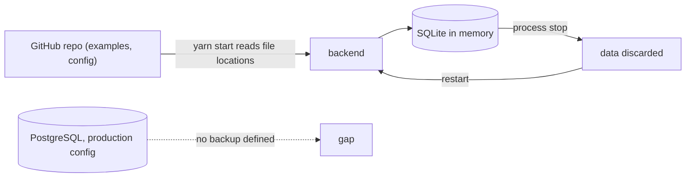

# 14 — Backup / DR

| Data | Where it lives | Persisted? | Backup / restore reality |
|---|---|---|---|
| Source code, config, catalog YAML (`examples/`, `catalog-info.yaml`) | GitHub `bookchaowalit/platform-developer-portal` (public) + local clone | yes (Git) | Git history is the only copy-of-record; no separate backup in repo |
| Runtime DB (entities, scaffolder tasks, user settings, notifications, search index) | dev: `better-sqlite3` `':memory:'` | **no** — lost when the backend stops; rebuilt from YAML on next start | nothing to back up |
| Runtime DB (production config) | PostgreSQL from `POSTGRES_*` env | would be | **not provisioned**; no backup job, not in any backup workflow in repo |
| TechDocs output | local publisher directory (`techdocs.publisher.type: local`) | local only | regenerated from source; no entity has TechDocs today |
| Repos created by scaffolder | GitHub | yes | GitHub's own durability; outside this repo |

- RTO: not defined
- RPO: not defined (dev: by design every restart = rebuild from Git)
- recovery today = `git clone` + `yarn install --immutable` + `yarn start` (README)

Sources: `app-config.yaml`, `app-config.production.yaml`, `README.md`, `PRODUCT.md`, `.github/workflows/ci.yml`

## Open questions
- ถ้า provision Postgres: จะเข้า nightly encrypted backup (ops-backups) เหมือน service อื่นหรือไม่ และ RTO/RPO เท่าไร
