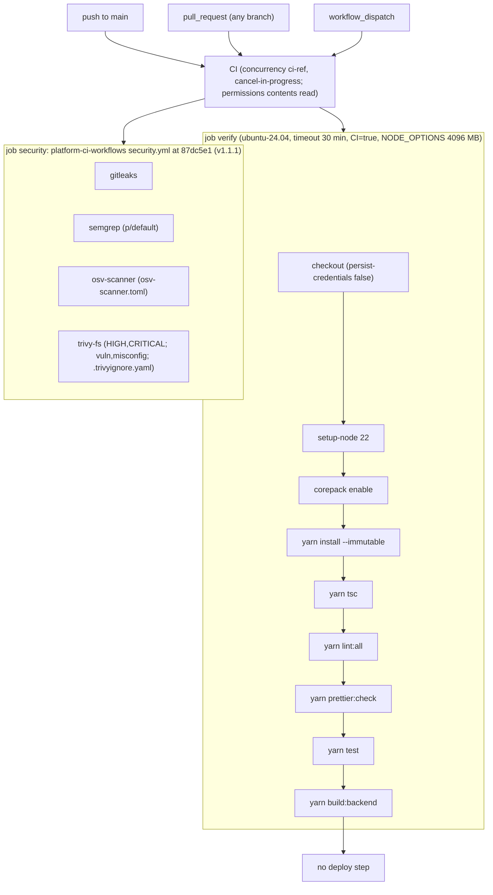

# 15 — CI/CD pipeline

workflow เดียว: `.github/workflows/ci.yml` (name `CI`) ไม่มี CD / deploy workflow

`verify` และ `security` ไม่มี `needs` ต่อกัน (รันขนาน) Renovate (`renovate.json`) เปิด PR dependency ทุกวันจันทร์ก่อน 9 โมง (Asia/Bangkok) และ lock file maintenance วันแรกของเดือน

ผล CI ล่าสุดบน `main`: `0c3d76f` success (2026-10-23); `12193c0` failure ที่ `security / osv-scanner` และ `security / trivy-fs`

Sources: `.github/workflows/ci.yml`, `platform-ci-workflows/.github/workflows/security.yml` (read-only, commit `87dc5e1`), `renovate.json`, `package.json`, `gh run list -R bookchaowalit/platform-developer-portal` (2026-11-04)
