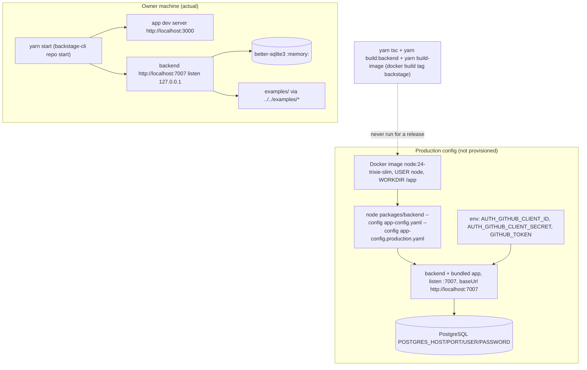

# 16 — Deployment

ไม่มี hosted deployment (`PRODUCT.md`) ที่รันจริงมีแค่เครื่อง owner ส่วน production เป็น config + Dockerfile ที่ยังไม่เคยใช้

- domain: none; `baseUrl` ทั้ง app และ backend ใน production config ยังเป็น `http://localhost:7007`
- image registry: none
- environments: development (local) เท่านั้น

Sources: `PRODUCT.md`, `README.md`, `package.json`, `packages/backend/package.json` (`build-image`), `packages/backend/Dockerfile`, `app-config.yaml`, `app-config.production.yaml`

## Open questions

- hosting target, domain และ secret store สำหรับ production (ยังไม่ตัดสินใจ)
