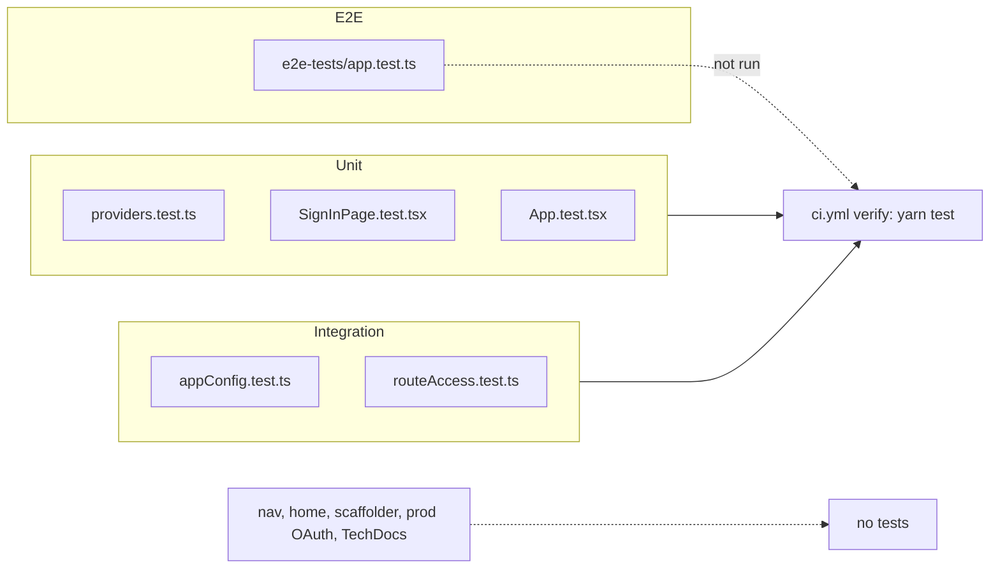

# 17 — Test coverage matrix

Test runner: Jest ผ่าน `backstage-cli repo test` (`yarn test`) และ Playwright (`yarn test:e2e`) UPGRADE-PLAN pass 2 บันทึกว่า "38 tests" ผ่าน (ไม่ได้รันซ้ำใน worktree นี้) ไม่มี coverage gate (`test:all --coverage` มีแต่ไม่อยู่ใน CI)

| Feature | Unit | Integration | E2E | In CI |
|---|---|---|---|---|
| Sign-in provider selection | `modules/signIn/providers.test.ts` | — | — | yes |
| Sign-in page per environment | `modules/signIn/SignInPage.test.tsx` (rendered via `renderInTestApp`) | — | — | yes |
| App renders | `App.test.tsx` | — | `e2e-tests/app.test.ts` (Enter, Catalog + APIs links) | unit yes, e2e **no** |
| Config: catalog file locations (dev + image) | — | `appConfig.test.ts` (real config loader) | — | yes |
| Config: production secrets from env, GitHub OAuth, no guest outside dev | — | `appConfig.test.ts` | — | yes |
| Config: listen host dev / prod | — | `appConfig.test.ts` | — | yes |
| Config: no literal credentials | — | `appConfig.test.ts` | — | yes |
| Backend route access per plugin | — | `routeAccess.test.ts` (`startTestBackend` with `features.ts`) | — | yes |
| Nav sidebar (`modules/nav`) | **gap** | — | partly via e2e | — |
| Home widget (`modules/home`) | **gap** | — | — | — |
| Scaffolder template run (`publish:github`) | — | **gap** | **gap** | — |
| Production GitHub sign-in end-to-end | — | **gap** | **gap** | — |
| TechDocs build | — | **gap** | — | — |

Sources: `packages/app/src/**/*.test.ts*`, `packages/backend/src/*.test.ts`, `packages/app/e2e-tests/app.test.ts`, `playwright.config.ts`, `package.json`, `.github/workflows/ci.yml`, `docs/UPGRADE-PLAN.md`
