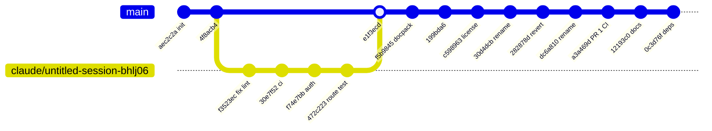
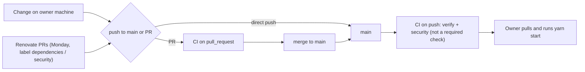

# 18 — Git / release workflow

default branch `main` (public) ไม่มี branch protection (`gh api .../branches/main/protection` → 404 "Branch not protected", 2026-11-04) ส่วนใหญ่ push ตรงเข้า `main`; มี PR เดียว (#1, merged 2026-10-17) และ merge commit หนึ่งจาก branch `claude/untitled-session-bhlj06` ไม่มี tag / release / deploy — "production" ไม่มี ทางเดียวที่ change ไปถึงคือ owner `git pull` + `yarn start` บนเครื่อง

Sources: `git log origin/main` (16 commits, 2026-09-06 → 2026-10-23), `gh pr list --state all`, `gh api repos/bookchaowalit/platform-developer-portal/branches/main/protection`, `.github/workflows/ci.yml`, `renovate.json`

## Open questions
- จะตั้ง branch protection / required check `verify` บน `main` หรือไม่
