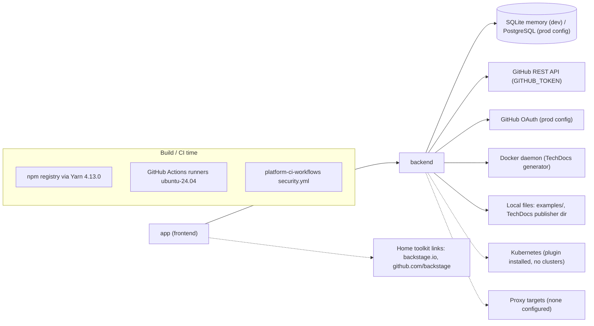

# 19 — Service dependency map

ไม่มี dependency runtime ต่อ service อื่นของ Solo Empire (identity, gateway, Sentry, PostHog, uptime) dashed = ติดตั้ง/ประกาศไว้แต่ไม่มีเป้าหมายใน config

Sources: `app-config.yaml`, `app-config.production.yaml`, `packages/backend/src/features.ts`, `packages/backend/package.json`, `package.json`, `.yarnrc.yml`, `.github/workflows/ci.yml`
