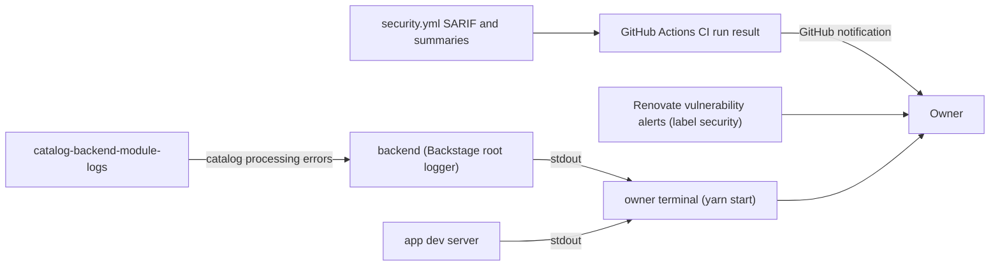

# 20 — Observability

instrumentation ที่มีจริงมีน้อย: ไม่มี Sentry (waiver ใน `PRODUCT.md`), ไม่มี PostHog, ไม่มี uptime target หรือ heartbeat (ไม่พบชื่อ repo นี้ใน `platform-uptime-worker` / `platform-posture-monitor` / `platform-api-gateway` / `platform-mcp-remote-worker` worktrees ที่ค้น 2026-11-04) สัญญาณที่มี:

| Signal             | Source                                                       | Watched by                | Gap                                       |
| ------------------ | ------------------------------------------------------------ | ------------------------- | ----------------------------------------- |
| Backend logs       | `@backstage/backend-defaults` logger, stdout                 | owner terminal            | no retention, no aggregation              |
| Catalog errors     | `catalog-backend-module-logs` (subscribes to catalog errors) | same logs                 | —                                         |
| CI status          | `ci.yml`                                                     | GitHub UI / notifications | `main` failed 6 of 9 push runs in 90 days |
| Dependency vulns   | osv-scanner, trivy-fs, Renovate alerts                       | CI + Renovate PRs         | ignore list expires 2027-01-17            |
| Errors (Sentry)    | —                                                            | —                         | waived until hosted deploy                |
| Uptime / heartbeat | —                                                            | —                         | not hosted                                |

Sources: `PRODUCT.md`, `packages/backend/src/features.ts`, `app-config.yaml`, `.github/workflows/ci.yml`, `renovate.json`, `osv-scanner.toml`, `gh run list` (2026-11-04)

## Open questions

- ก่อน hosted deploy: Sentry project, uptime target และ heartbeat จะตั้งที่ไหน
