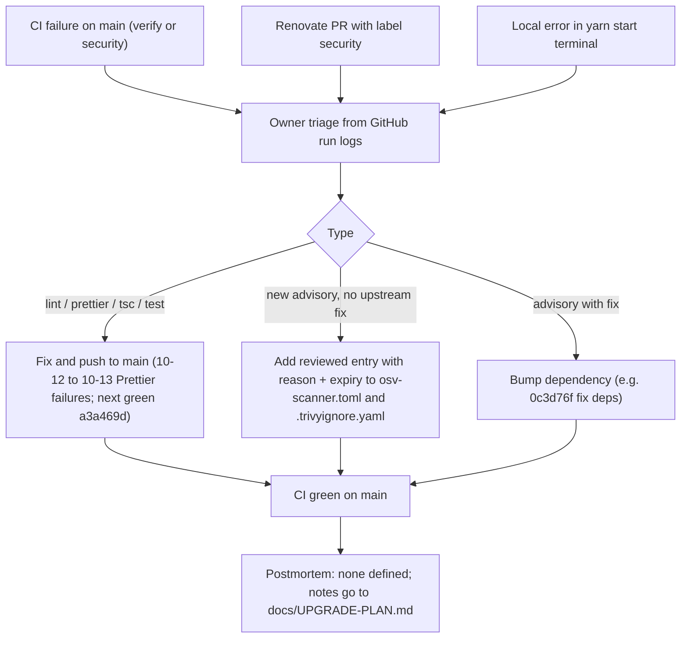

# 21 — Incident response

ไม่มี hosted runtime จึงไม่มี production incident ในความหมายปกติ alert channel ที่พบจริงมีสองทาง: ผล CI บน GitHub และ Renovate vulnerability alerts (label `security`) ทั้งสองไปถึง owner ผ่าน GitHub เท่านั้น — ไม่มี Telegram / pager ใน repo

ตัวอย่างจริงใน 90 วัน: 2026-10-12 → 10-13 CI บน `main` fail 5 ครั้งติด (4 ครั้งที่ขั้น Prettier, 1 ครั้งไม่มีข้อมูล step) แล้วกลับมาเขียวที่ `a3a469d` (2026-10-17); `12193c0` (2026-10-23 15:04 UTC) fail ที่ osv-scanner + trivy-fs แล้วแก้ด้วย `0c3d76f` 8 นาทีต่อมา

Sources: `.github/workflows/ci.yml`, `renovate.json`, `osv-scanner.toml`, `.trivyignore.yaml`, `docs/UPGRADE-PLAN.md`, `gh run list` / `gh run view` (2026-11-04), `git log origin/main`

## Open questions
- เมื่อ host แล้ว: alert จะเข้า Telegram เหมือน service อื่นหรือไม่ และ postmortem เก็บที่ไหน
- run `38219648436` (2026-10-12) fail โดยไม่มีข้อมูล step — สาเหตุ (runner / setup) ไม่ทราบ
