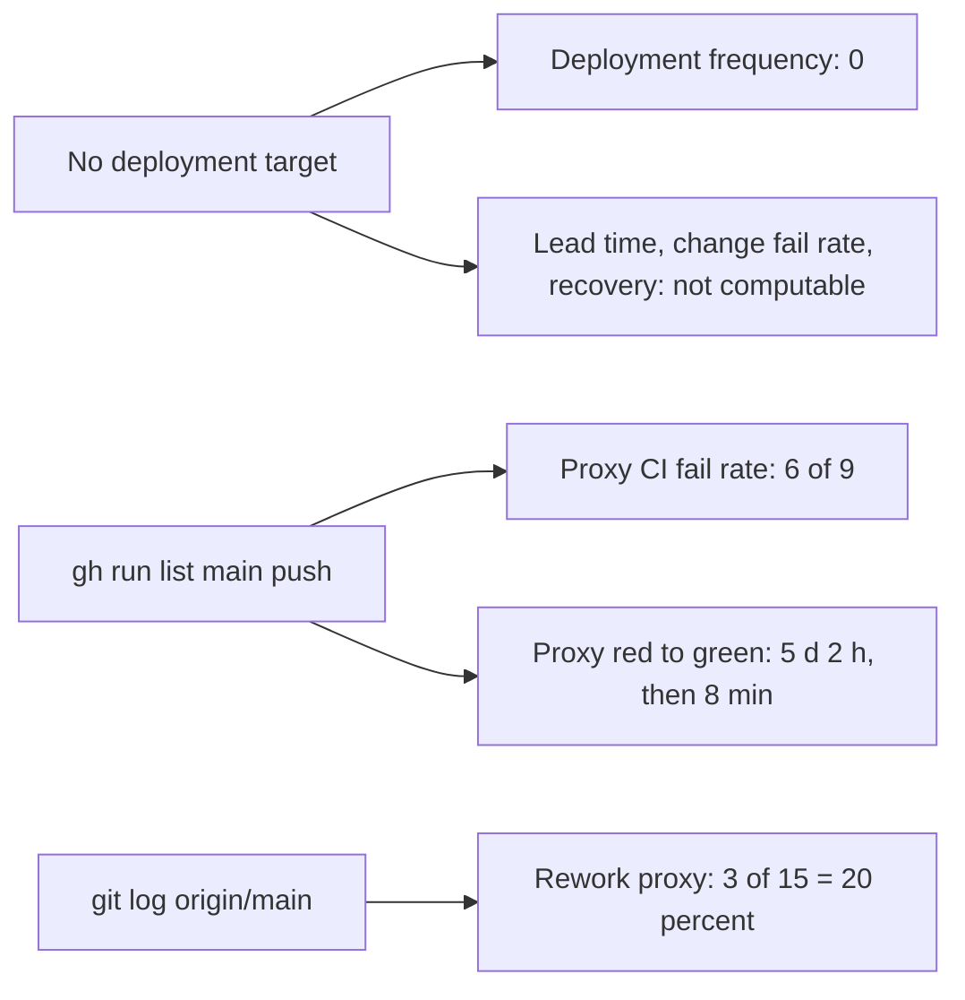

# 22 — DORA metrics

หน้าต่าง: 90 วันถึง 2026-11-04 (`--since="90 days ago"` = ตั้งแต่ 2026-08-06; ครอบทุก commit ของ repo ตั้งแต่ initial 2026-09-06) **repo นี้ไม่มี deployment เลย** (ไม่มี hosted target, ไม่มี deploy workflow, ไม่เคย build image ตาม `PRODUCT.md`) metric ที่ต้องใช้ deploy จึงคำนวณไม่ได้ ใช้ CI บน `main` เป็น proxy ที่ระบุชัด

| Metric                          | How to measure for this repo                                               | Current value (90 d)                                                                                                                                                 | Command                                                                                                            | Confidence                          |
| ------------------------------- | -------------------------------------------------------------------------- | -------------------------------------------------------------------------------------------------------------------------------------------------------------------- | ------------------------------------------------------------------------------------------------------------------ | ----------------------------------- |
| Deployment frequency            | deploys to a hosted environment                                            | **0 — no deployment target exists**                                                                                                                                  | —                                                                                                                  | high (no deploy config in repo)     |
| Lead time for changes           | commit → deploy                                                            | **not computable (no deploy)**; proxy commit → CI run start on `main`: `0c3d76f` 3 s, `12193c0` 4 s, `a3a469d` 4 s (PR #1: opened 09:22 → merged 09:43 UTC = 21 min) | `git show -s --format=%cI <sha>` vs `gh run list ... createdAt`; `gh pr list --state all`                          | low (proxy)                         |
| Change fail rate                | failed deploys / deploys                                                   | **not computable (no deploy)**; proxy: failed CI push runs on `main` = **6 / 9 = 67 %**                                                                              | `gh run list -R bookchaowalit/platform-developer-portal --branch main --event push --limit 100 --json conclusion`  | low (proxy)                         |
| Failed deployment recovery time | failed deploy → next good deploy                                           | **not computable (no deploy)**; proxy red → green on `main`: 10-12 07:46 → 10-17 09:43 UTC ≈ 5 d 2 h; 10-23 15:04 → 15:12 UTC = 8 min                                | `gh run list` createdAt of first failure and next success                                                          | low (proxy)                         |
| Deployment rework rate          | share of non-merge commits on `main` whose subject starts `fix` / `revert` | **3 / 15 = 20 %** (`f3523ec`, `282878d`, `0c3d76f`)                                                                                                                  | `git log origin/main --since="90 days ago" --no-merges --format=%s \| grep -ciE '^(fix\|revert)'` ; `... \| wc -l` | low: commit proxy, not deploy-level |



Commands used (2026-11-04):

```bash
git log origin/main --since="90 days ago" --no-merges --format=%s | wc -l                      # 15
git log origin/main --since="90 days ago" --no-merges --format=%s | grep -ciE '^(fix|revert)'   # 3
gh run list -R bookchaowalit/platform-developer-portal --limit 100 \
  --json conclusion,event,headBranch,createdAt,headSha                                         # 10 runs; main push 3 success, 6 failure; 1 PR run success
gh pr list -R bookchaowalit/platform-developer-portal --state all --json number,createdAt,mergedAt
```

Sources: `git log origin/main`, `gh run list`, `gh run view`, `gh pr list` (2026-11-04), `PRODUCT.md`, `.github/workflows/ci.yml`

## Open questions

- ถ้า host ในอนาคต: แหล่งนับ deploy (Railway deployments หรือ workflow) จะเป็นอะไร
